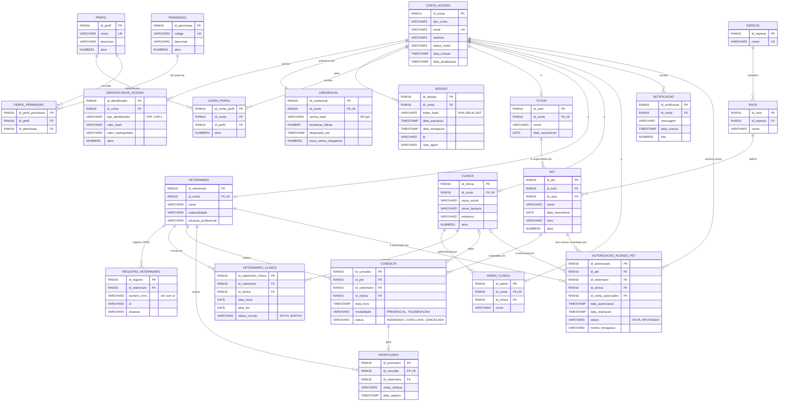

# 🗄️ DER: Modelo de Dados do Clyvo Vet

Diagrama gerado a partir das migrations Flyway [`V1..V6`](../src/main/resources/db/migration) (Oracle, 3ª Forma Normal).
O GitHub renderiza o diagrama Mermaid abaixo automaticamente.

## Decisões de modelagem

| Decisão | Por quê |
|---|---|
| **`conta_acesso` separada dos perfis** (`tutor`, `veterinario`, `clinica`) | Login, credencial e sessão são iguais para todos; os dados de cada ator ficam na própria tabela (3FN, sem colunas nulas por tipo). |
| **`credencial` e `identificador_acesso` fora da conta** | Senha e documentos (CPF/CNPJ) são dados sensíveis: ficam isolados, com hash, e podem mudar sem tocar na conta. |
| **`veterinario_clinica` (N:N com histórico)** | Um veterinário atende em várias clínicas; `data_inicio`/`data_fim` e `status_vinculo` guardam o histórico em vez de apagar o vínculo. |
| **`especie` → `raca` → `pet`** | Catálogo normalizado (V2) em vez de texto livre, evitando "Labrador" e "labrador" como valores diferentes. |
| **`prontuario` separado de `consulta` (1:0..1)** | A anotação clínica tem autor e data próprios; a consulta pode existir sem prontuário (agendada ou cancelada). |
| **`autorizacao_acesso_pet`** | Materializa o consentimento LGPD: quem autorizou, para qual profissional ou clínica, quando e o motivo de uma revogação. |
| **`sessao` com `token_hash`** | Permite revogar um JWT antes da expiração (logout), sem guardar o token em texto puro. |

## Padrões Oracle

* Chaves primárias `RAW(16) DEFAULT SYS_GUID()` (UUID).
* Booleanos como `NUMBER(1)` (`0`/`1`).
* Textos longos em `VARCHAR2(4000)`.
* Constraints nomeadas (`fk_*`, `uk_*`) para facilitar a leitura dos erros.
