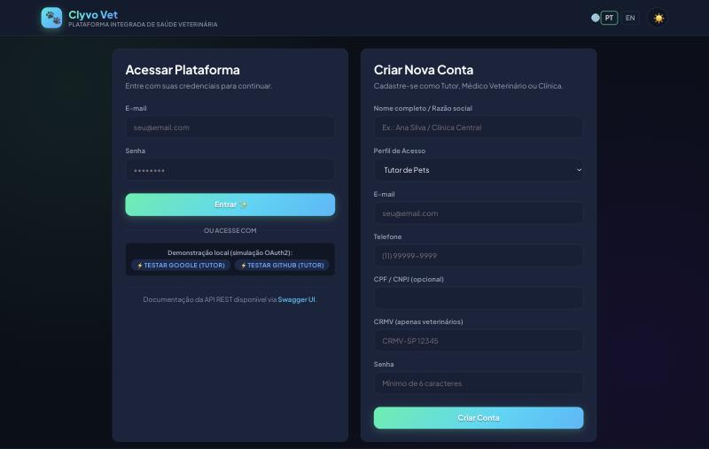
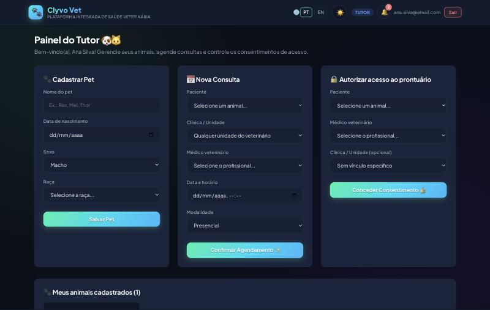
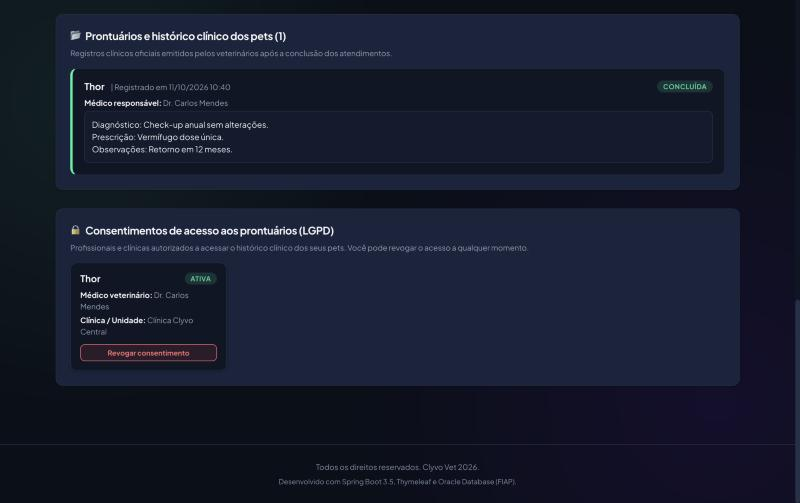
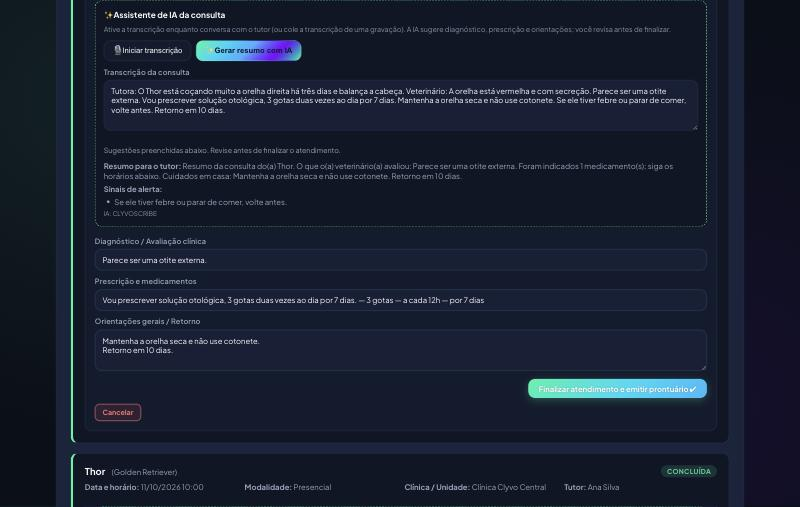
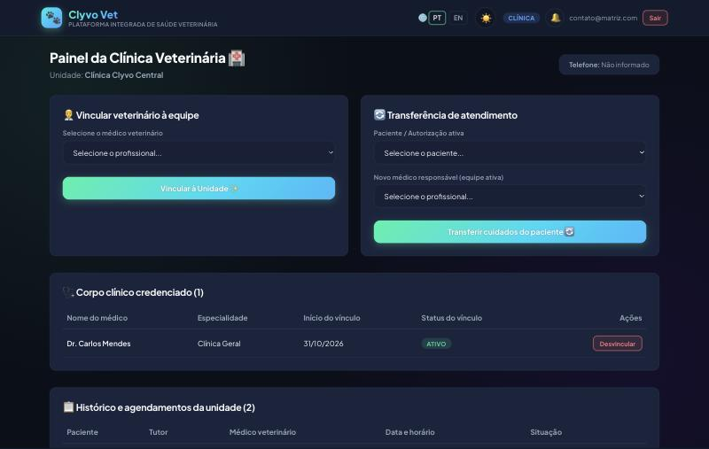
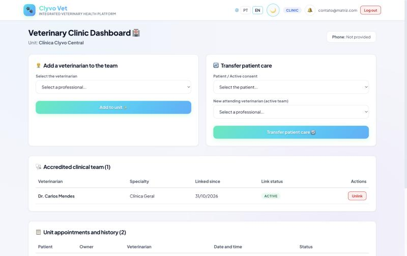
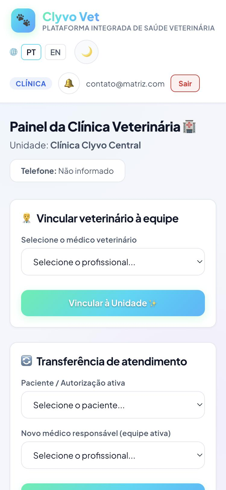

# 🖼️ Protótipo navegável: telas da aplicação

Telas reais do Clyvo Vet, capturadas da aplicação rodando com os dados de demonstração. Cada uma mostra um dos fluxos apresentados no vídeo.

| # | Tela | O que mostra |
|:-:|---|---|
| 1 |  | **Login e cadastro** com os três perfis, login social (OAuth2 Google/GitHub) e acesso ao Swagger. |
| 2 |  | **Tutor:** cadastro de pet, agendamento de consulta (presencial ou telemedicina) e concessão de acesso ao prontuário. |
| 3 |  | **Tutor:** prontuário emitido pelo veterinário e consentimentos ativos, com o botão de revogar (LGPD). |
| 4 |  | **Veterinário:** assistente de IA da teleconsulta. A transcrição vira diagnóstico, prescrição, orientações, resumo para o tutor e sinais de alerta. |
| 5 |  | **Clínica:** vínculo de veterinários à equipe, transferência de atendimento e agenda da unidade. |
| 6 |  | **UI/UX:** tema claro e interface em inglês (i18n PT/EN). |
| 7 |  | **Responsivo:** a mesma tela em um celular (375 px). |
